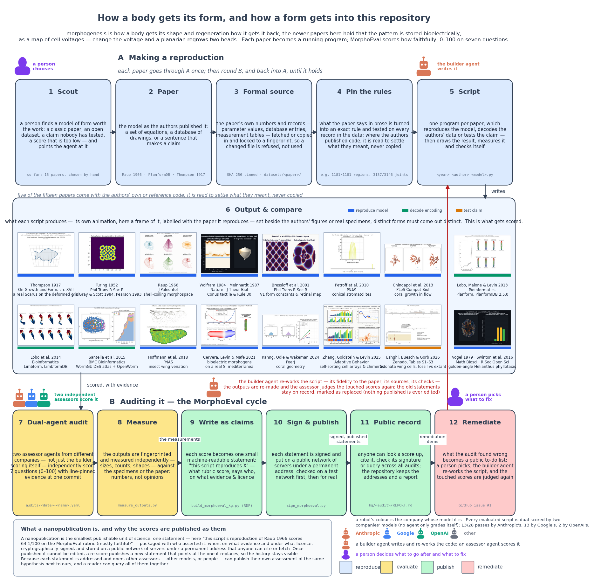

# Project Delphi — Closed-Loop Frontier Model Orchestration, Prompts & Gates

> **Clean, zero-dependency reference repository** showing how Project Delphi integrates frontier models (`claude-fable-5-1`, `gemini-4-argon`, `gpt-5.6-sol`) in a closed loop with **deterministic verification gates**, **blinded cross-provider refereeing**, and **RDF Nanopublication (`pk:evidenceAgainst`) feedback**.


*12-Step Closed-Loop Architecture ([animated GIF](./media/delphi_12step_closed_loop.gif) · [high-res dark PNG](./media/delphi_12step_closed_loop.png) · [15-paper corpus overview GIF](./media/morphoeval_pipeline.gif)). Every frontier LLM step is bracketed by a deterministic gate (`gates/1_verify_inputs.py`, `gates/2_measure_sidecar.py`, `gates/3_compile_and_query_kg.py`). In Step 7, two models from different companies score the work in isolated worktrees; Step 9 compiles any defects into `pk:evidenceAgainst` RDF triples; and Step 12 feeds those triples back into Step 5 (`prompts/03_remediation_prompt.md`).*

---

## Run the Complete Closed Loop in One Command

Requires **only the Python 3 standard library** (and runs `lean` automatically if installed):

```bash
python3 run_loop.py
```

---

## 1. Full 12-Step Closed-Loop Architecture (Two Views)

### View A — Single-Cycle Dark-Mode Architecture (Prompts, Gates & `pk:evidenceAgainst` Feedback)


### View B — Corpus-Wide 12-Step MorphoEval Pipeline (Showing Person vs. Multi-Company Agent Roles)


---

## 2. Exactly What Is Passed Between Every Component in the System

| Edge | Producer Component | Consumer Component | Exact File / Payload Passed | Exact Schema & Fields | Deterministic Verification Gate |
| :-: | :--- | :--- | :--- | :--- | :--- |
| **`E1`** | **Gate 1 (Steps 1–4)** (`gates/1_verify_inputs.py`) | **Builder Agent (Step 5)** (`prompts/01_builder_prompt.md`) | `example/data.csv`, `example/law.lean`, `rubric.json` | CSV: `specimen_id, region, length_mm, mass_g` (12 rows); Lean theorem `unit_length_recovers_prefactor` | `hashlib.sha256` must equal `8cc91f52...`; `lean example/law.lean` must exit `0` with `0 sorry` |
| **`E2`** | **Builder Agent (Steps 5–6)** (`example/pass1_naive_fit.py`) | **Gate 2 Sidecar (Step 8)** (`gates/2_measure_sidecar.py`) | `example/pass1_metrics.json` | `{"pass": 1, "script": "...", "fitted_params": {...}, "predictions": [12 floats], "reported_rmse_all": 44.2323, "reported_r2_all": -0.2461}` | Gate 2 hashes the file (`SHA-256: 26455f9f...`) and asserts `len(predictions) == 12` |
| **`E3`** | **Gate 2 Sidecar (Step 8)** (`gates/2_measure_sidecar.py`) | **Blinded Referee Agent (Step 7)** (`prompts/02_referee_prompt.md`) | `kg/pass1_sidecar.json` | `{"artifact_sha256": "...", "independent_measurements": {"rmse_all_g": 44.2323, "r2_all": -0.2461, "mae_head_subset_g": 0.0945, "mae_body_subset_g": 51.7015}}` | Zero-LLM Python verifier independently re-derives $R^2$ and RMSE against `data.csv` and aborts if `|ΔRMSE| > 0.001` |
| **`E4`** | **Blinded Referee Agent (Step 7)** (`gemini-4-argon`) | **Gate 3 KG Compiler (Steps 9–11)** (`gates/3_compile_and_query_kg.py`) | `kg/pass1_audit.json` | `{"assessor_model": "gemini-4-argon", "blinded": true, "scores": {<7 rubric dims 0-100>}, "remediation": ["remediation needed: ..."]}` | Referee runs in an isolated worktree without prior audits; Gate 3 checks all 7 rubric weights sum to `100` |
| **`E5`** | **Gate 3 KG Compiler (Steps 9–11)** (`kg/pass1_claim.trig`) | **Pass 2 Remediation Agent (Step 12 $\to$ Step 5)** (`prompts/03_remediation_prompt.md`) | `pk:evidenceAgainst` RDF triples from `kg/pass1_claim.trig` | RDF literals: `"remediation needed: Fit the power law y = a * x^b across the full organism (all 12 rows)..."` | Extracted via deterministic query over `kg/pass1_claim.trig` (`Score: 49.4/100 < 80`) |
| **`E6`** | **Pass 2 Remediation Agent (Step 5 v2)** (`example/pass2_remediated_fit.py`) | **Gates 2 & 3 (Steps 7–11 v2)** | `example/pass2_metrics.json` $\to$ `kg/pass2_claim.trig` | `r2_all: 1.0000`, `rmse_all_g: 0.0227`, `pk:hasScore "0.9470"`, `npx:supersedes <.../pass1-example-claim>` | `0` `pk:evidenceAgainst` items remain; score reaches **`94.7 / 100`** (`>= 80` faithful band) $\to$ **Loop Converges** |

---

## 3. Repository File Map

```text
project-delphi-loop/
├── README.md                        # Full closed-loop diagrams, 6-edge contract table & prompts
├── run_loop.py                      # Single-command runner executing all 7 stages (Pass 1 -> Pass 2)
├── rubric.json                      # 7 weighted evaluation dimensions (weights sum to 100)
├── media/
│   ├── delphi_12step_closed_loop.gif # Animated 12-step closed-loop architecture (Pass 1 -> Pass 2)
│   ├── delphi_12step_closed_loop.png # High-res dark-mode 12-step closed-loop diagram
│   ├── morphoeval_pipeline.gif       # Animated 15-paper corpus pipeline diagram
│   └── morphoeval_pipeline.png       # Static 15-paper corpus pipeline diagram
├── prompts/
│   ├── 01_builder_prompt.md         # Verbatim prompt + input/output contract for Builder Agent
│   ├── 02_referee_prompt.md         # Verbatim prompt + worktree blinding rules for Referee Agent
│   └── 03_remediation_prompt.md     # Verbatim prompt injecting KG `pk:evidenceAgainst` into Pass 2
├── gates/
│   ├── 1_verify_inputs.py           # Gate 1: SHA-256 data check + Lean 4 (`0 sorry`) kernel check
│   ├── 2_measure_sidecar.py         # Gate 2: Zero-LLM sidecar re-computing RMSE, R^2, Head/Body MAE
│   └── 3_compile_and_query_kg.py    # Gate 3: Emits RDF Nanopub `.trig` & queries `pk:evidenceAgainst`
├── example/
│   ├── data.csv                     # 12-row dataset (6 `head` rows + 6 `body` rows, SHA-256 pinned)
│   ├── law.lean                     # 18-line Lean 4 proof checked by Gate 1 (`0 sorry`)
│   ├── pass1_naive_fit.py           # Pass 1 Builder output (fits only `head` rows -> R^2 = -0.25)
│   └── pass2_remediated_fit.py      # Pass 2 Builder output (fixes `pk:evidenceAgainst` -> R^2 = 1.00)
└── kg/
    ├── pass1_sidecar.json           # Gate 2 independent verification of Pass 1
    ├── pass1_audit.json             # Blinded Referee scores (49.4/100) + 2 remediation items
    ├── pass1_claim.trig             # Pass 1 RDF Nanopub containing `pk:evidenceAgainst`
    ├── pass2_sidecar.json           # Gate 2 independent verification of Pass 2
    ├── pass2_audit.json             # Blinded Referee re-score (94.7/100, 0 remediation items)
    └── pass2_claim.trig             # Pass 2 RDF Nanopub with `npx:supersedes` pointing to Pass 1
```

---

## 4. The 3 Orchestration Prompts (Verbatim)

### Prompt 1 — Frontier Builder Agent (`prompts/01_builder_prompt.md`)
```markdown
You are the Builder Agent in the Project Delphi closed-loop scientific pipeline.

## INPUT PAYLOADS PROVIDED IN WORKSPACE
1. Empirical dataset: `example/data.csv` (SHA-256 verified by `gates/1_verify_inputs.py`).
2. Formal mathematical law: `example/law.lean` (verified by Lean 4 with `0 sorry`).
3. Evaluation rubric: `rubric.json` (7 weighted dimensions on 0–100).

## TASK
Write a deterministic Python script `example/pass1_naive_fit.py` that loads `example/data.csv`, fits a mathematical model predicting `mass_g` from `length_mm`, and writes the structured output contract to `example/pass1_metrics.json`:
{
  "pass": 1,
  "script": "example/pass1_naive_fit.py",
  "model_equation": "<equation string>",
  "fitted_params": { ... },
  "predictions": [ <12 float predictions matching the 12 rows of example/data.csv> ],
  "reported_rmse_all": <float>,
  "reported_r2_all": <float>
}

Your output JSON will be hashed and independently re-verified by Gate 2 (`gates/2_measure_sidecar.py`) before being audited by a blinded referee model from a second AI provider.
```

### Prompt 2 — Blinded Cross-Provider Referee Agent (`prompts/02_referee_prompt.md`)
```markdown
You are acting as an independent, blinded referee (`blinded: true`) for the Project Delphi benchmark.

## STRICT ISOLATION PROTOCOL
You are running in an isolated worktree containing ONLY:
1. `rubric.json` (7 weighted dimensions on 0–100: `model-fidelity` [20], `empirical-match` [25], `parameter-expressivity` [10], `quantitative-validation` [15], `data-traceability` [10], `code-traceability` [8], `reproducibility` [12]).
2. The Builder's script: `<target_script>`.
3. The deterministic sidecar measurement file: `kg/pass<N>_sidecar.json` (generated by the zero-LLM verifier `gates/2_measure_sidecar.py`).

## TASK
1. Inspect every line of `<target_script>` alongside the independent metrics in `kg/pass<N>_sidecar.json` (`rmse_all_g`, `r2_all`, `mae_head_subset_g`, `mae_body_subset_g`).
2. Score all 7 dimensions in `kg/pass<N>_audit.json` on the 0–100 scale, citing exact line numbers in `<target_script>`.
3. If any dimension scores below 80, write concrete, falsifiable engineering fixes under `remediation`. Gate 3 (`gates/3_compile_and_query_kg.py`) will compile these items into `pk:evidenceAgainst` RDF triples in `kg/pass<N>_claim.trig` to drive the next pass.
```

### Prompt 3 — Knowledge-Graph-Driven Remediation Agent (`prompts/03_remediation_prompt.md`)
```markdown
You are executing Pass 2 (Closed-Loop Remediation) of the Project Delphi pipeline.

## WHY PASS 1 FAILED (SCORE: 49.4 / 100)
Querying the signed Pass 1 RDF Nanopublication (`kg/pass1_claim.trig`) returned the following `pk:evidenceAgainst` triples recorded by the Blinded Referee and verified by `kg/pass1_sidecar.json` (`r2_all = -0.2461`, `mae_head_subset_g = 0.0945 g`, `mae_body_subset_g = 51.7015 g`):

1. "remediation needed: Fit the power law y = a * x^b across the full organism (all 12 rows of example/data.csv, accounting for both head and body modules) instead of fitting a linear line only to the 6 head rows (line 49)."
2. "remediation needed: Report the fitted power-law exponents b_head and b_body and verify that full-dataset R^2 exceeds 0.99."

## TASK
Write `example/pass2_remediated_fit.py` fixing every `pk:evidenceAgainst` item above, and emit `example/pass2_metrics.json`. Your new output will be re-checked by `gates/2_measure_sidecar.py --pass-num 2` and `gates/3_compile_and_query_kg.py --pass-num 2` (which will mint `kg/pass2_claim.trig` with `npx:supersedes <https://w3id.org/delphi/np/pass1-example-claim>`).
```

---

## 5. Exact Output of `python3 run_loop.py`

```text
==========================================================================================
 PROJECT DELPHI — MINIMAL CLOSED-LOOP FRONTIER MODEL ORCHESTRATION & DETERMINISTIC GATES
==========================================================================================

>>> STEP 1: Gate 1 — Verify SHA-256 Data Pin & Lean 4 Formal Law
  [Gate 1 PASS] Data pin verified: `example/data.csv` (SHA-256: 8cc91f5297493571...)
  [Gate 1 PASS] Lean 4 kernel verified `example/law.lean` (exit 0, 0 sorry)

>>> STEP 2: Pass 1 Builder Agent Output (`prompts/01_builder_prompt.md`)
  [Pass 1 Builder] Wrote `example/pass1_metrics.json`: RMSE=44.2323 g, R^2=-0.2461

>>> STEP 3: Gate 2 — Zero-LLM Sidecar Verification (Pass 1)
  [Gate 2 PASS] Sidecar `kg/pass1_sidecar.json` verified `pass1_metrics.json` (SHA-256=26455f9f9c24...)
                Independent R^2 = -0.2461 | RMSE = 44.2323 g (Head MAE = 0.0945 g, Body MAE = 51.7015 g)

>>> STEP 4: Gate 3 — Blinded Referee Score & KG `pk:evidenceAgainst` Query (Pass 1)
  [Gate 3 PASS] Compiled `kg/pass1_claim.trig` | Assessor: `gemini-4-argon` (Google DeepMind) | Weighted Rubric Score: 49.4 / 100
  [KG QUERY] Extracted 2 `pk:evidenceAgainst` item(s) to inject into Remediation Prompt:
             (1) remediation needed: Fit the power law y = a * x^b across the full organism (all 12 rows of example/data.csv, accounting for both head and body modules) instead of fitting a linear line only to the 6 head rows (line 49).
             (2) remediation needed: Report the fitted power-law exponents b_head and b_body and verify that full-dataset R^2 exceeds 0.99.

>>> STEP 5: Pass 2 Remediation Builder Output (`prompts/03_remediation_prompt.md`)
  [Pass 2 Builder] Wrote `example/pass2_metrics.json`: RMSE=0.0227 g, R^2=1.000000

>>> STEP 6: Gate 2 — Zero-LLM Sidecar Verification (Pass 2)
  [Gate 2 PASS] Sidecar `kg/pass2_sidecar.json` verified `pass2_metrics.json` (SHA-256=ddb638b2e99b...)
                Independent R^2 = 1.0000 | RMSE = 0.0227 g (Head MAE = 0.0051 g, Body MAE = 0.0286 g)

>>> STEP 7: Gate 3 — Superseding Nanopub (`npx:supersedes`) & Convergence Check (Pass 2)
  [Gate 3 PASS] Compiled `kg/pass2_claim.trig` | Assessor: `gemini-4-argon` (Google DeepMind) | Weighted Rubric Score: 94.7 / 100
  [KG QUERY] 0 `pk:evidenceAgainst` items remaining -> Loop Converged (>= 80 Faithful Band)!
```
