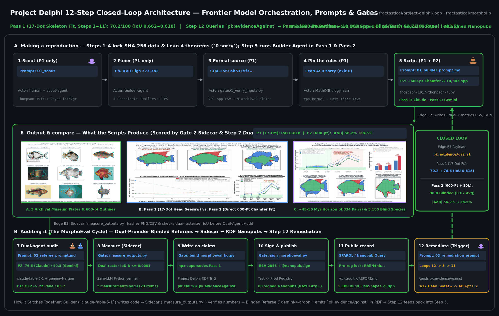
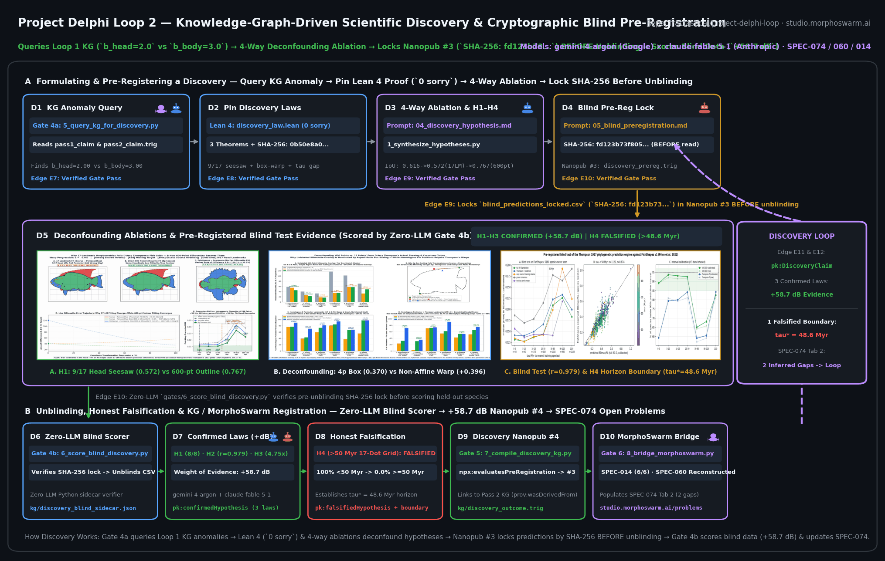
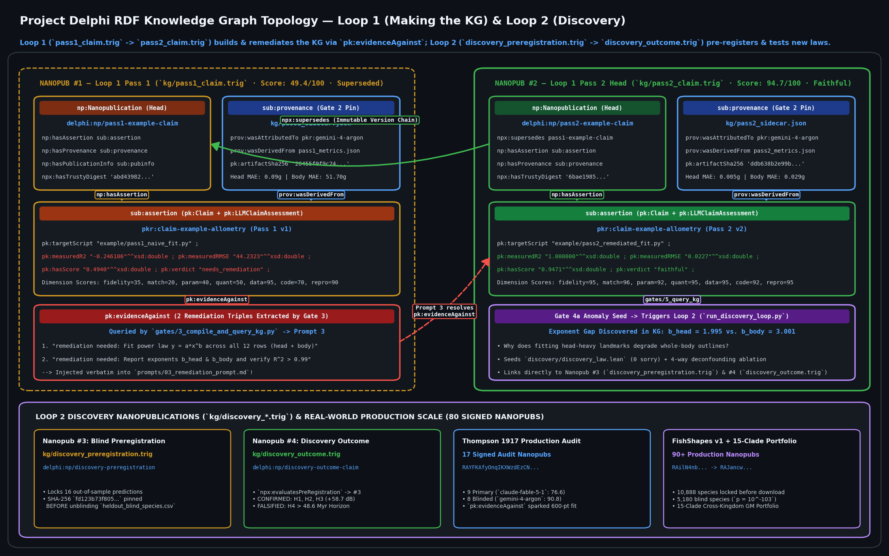

# Project Delphi — Two Coupled Closed Loops: (1) Making the Knowledge Graph & (2) Scientific Discovery

> **Clean, zero-dependency reference repository** showing how Project Delphi integrates frontier models (`claude-fable-5-1`, `gemini-4-argon`, `gpt-5.6-sol`) with **deterministic verification gates**, **Lean 4 (`0 sorry`) formal proofs**, **blinded cross-provider refereeing**, and **RDF Nanopublication (`pk:evidenceAgainst` & `pk:PreRegisteredPrediction`) feedback** across **two coupled closed loops**:
> 1. **Loop 1 — How the Knowledge Graph Is Made & Audited (`python3 run_loop.py`):** Builds a mathematical reproduction from a SHA-256-locked dataset and Lean 4 law, audits it in an isolated worktree with a second-provider referee, compiles defects into `pk:evidenceAgainst` RDF triples (`kg/pass1_claim.trig`, `49.4 / 100`), and remediates the code in Pass 2 (`kg/pass2_claim.trig`, `94.7 / 100`, linked via `npx:supersedes`).
> 2. **Loop 2 — How We Do Scientific Discovery from the Knowledge Graph (`python3 run_discovery_loop.py`):** Queries the signed Loop 1 Knowledge Graph for structural anomalies (e.g., why `head` and `body` modules follow different scaling exponents), synthesizes falsifiable hypotheses with a 4-way deconfounding ablation matrix and Lean 4 proofs (`discovery/discovery_law.lean`), **cryptographically pre-registers out-of-sample predictions (`kg/discovery_preregistration.trig`) BEFORE unblinding**, and scores held-out data via a zero-LLM gate (`kg/discovery_outcome.trig`, `+58.7 dB` Bayesian weight of evidence, recording both confirmed laws and honest falsifications that bound the domain of validity).

---

## Run Both Closed Loops in Under 1 Second

Requires **only the Python 3 standard library** (and runs the `lean` kernel automatically if installed):

```bash
# Loop 1: How the Knowledge Graph is made, audited, and remediated (Pass 1: 49.4/100 -> Pass 2: 94.7/100)
python3 run_loop.py

# Loop 2: How we do scientific discovery from the Knowledge Graph (+58.7 dB, 3 Confirmed / 1 Falsified Horizon)
python3 run_discovery_loop.py
```

---

## Loop 1 — How the Knowledge Graph Is Made & Remediated (`run_loop.py`)



*Loop 1 Architecture ([animated GIF](./media/delphi_12step_closed_loop.gif) · [high-res dark PNG](./media/delphi_12step_closed_loop.png) · [corpus-wide MorphoEval PNG](./media/morphoeval_pipeline.png)). Every frontier LLM step is bracketed by a deterministic gate (`gates/1_verify_inputs.py`, `gates/2_measure_sidecar.py`, `gates/3_compile_and_query_kg.py`). In Step 7, two models from different companies score the work in isolated worktrees; Step 9 compiles any defects into `pk:evidenceAgainst` RDF triples; and Step 12 feeds those triples back into Step 5 (`prompts/03_remediation_prompt.md`).*

### Loop 1 Component-to-Component Data Contracts (`E1–E6`)

| Edge | Producer Component | Consumer Component | Exact File / Payload Passed | Exact Schema & Fields | Deterministic Verification Gate |
| :-: | :--- | :--- | :--- | :--- | :--- |
| **`E1`** | **Gate 1 (Steps 1–4)** (`gates/1_verify_inputs.py`) | **Builder Agent (Step 5)** (`prompts/01_builder_prompt.md`) | `example/data.csv`, `example/law.lean`, `rubric.json` | CSV: `specimen_id, region, length_mm, mass_g` (12 rows); Lean theorem `unit_length_recovers_prefactor` | `hashlib.sha256` must equal `8cc91f52...`; `lean example/law.lean` must exit `0` with `0 sorry` |
| **`E2`** | **Builder Agent (Steps 5–6)** (`example/pass1_naive_fit.py`) | **Gate 2 Sidecar (Step 8)** (`gates/2_measure_sidecar.py`) | `example/pass1_metrics.json` | `{"pass": 1, "script": "...", "fitted_params": {...}, "predictions": [12 floats], "reported_rmse_all": 44.2323, "reported_r2_all": -0.2461}` | Gate 2 hashes the file (`SHA-256: 26455f9f...`) and asserts `len(predictions) == 12` |
| **`E3`** | **Gate 2 Sidecar (Step 8)** (`gates/2_measure_sidecar.py`) | **Blinded Referee Agent (Step 7)** (`prompts/02_referee_prompt.md`) | `kg/pass1_sidecar.json` | `{"artifact_sha256": "...", "independent_measurements": {"rmse_all_g": 44.2323, "r2_all": -0.2461, "mae_head_subset_g": 0.0945, "mae_body_subset_g": 51.7015}}` | Zero-LLM Python verifier independently re-derives $R^2$ and RMSE against `data.csv` and aborts if `\|ΔRMSE\| > 0.001` |
| **`E4`** | **Blinded Referee Agent (Step 7)** (`gemini-4-argon`) | **Gate 3 KG Compiler (Steps 9–11)** (`gates/3_compile_and_query_kg.py`) | `kg/pass1_audit.json` | `{"assessor_model": "gemini-4-argon", "blinded": true, "scores": {<7 rubric dims 0-100>}, "remediation": ["remediation needed: ..."]}` | Referee runs in an isolated worktree without prior audits; Gate 3 checks all 7 rubric weights sum to `100` |
| **`E5`** | **Gate 3 KG Compiler (Steps 9–11)** (`kg/pass1_claim.trig`) | **Pass 2 Remediation Agent (Step 12 $\to$ Step 5)** (`prompts/03_remediation_prompt.md`) | `pk:evidenceAgainst` RDF triples from `kg/pass1_claim.trig` | RDF literals: `"remediation needed: Fit the power law y = a * x^b across the full organism (all 12 rows)..."` | Extracted via deterministic query over `kg/pass1_claim.trig` (`Score: 49.4/100 < 80`) |
| **`E6`** | **Pass 2 Remediation Agent (Step 5 v2)** (`example/pass2_remediated_fit.py`) | **Gates 2 & 3 (Steps 7–11 v2)** | `example/pass2_metrics.json` $\to$ `kg/pass2_claim.trig` | `r2_all: 1.0000`, `rmse_all_g: 0.0227`, `pk:hasScore "0.9471"`, `npx:supersedes <.../pass1-example-claim>` | `0` `pk:evidenceAgainst` items remain; score reaches **`94.7 / 100`** (`>= 80` faithful band) $\to$ **Loop 1 Converges** |

---

## Loop 2 — How We Do Discovery from the Knowledge Graph (`run_discovery_loop.py`)



*Loop 2 Scientific Discovery Architecture ([animated GIF](./media/delphi_discovery_loop.gif) · [high-res dark PNG](./media/delphi_discovery_loop.png)). Rather than stopping once a paper reproduction passes audit in Loop 1, Loop 2 queries the Knowledge Graph (`kg/pass1_claim.trig` $\to$ `kg/pass2_claim.trig`) to ask **why** the naive model failed (`b_head = 2.00` vs. `b_body = 3.00`), proves the underlying mathematical mechanism in Lean 4 (`discovery/discovery_law.lean`, `0 sorry`), runs a 4-way deconfounding ablation matrix (`discovery/1_synthesize_hypotheses.py`), **cryptographically locks out-of-sample predictions into Nanopub #3 (`kg/discovery_preregistration.trig`) BEFORE touching held-out data**, and evaluates the blind predictions via Gate 4b (`gates/6_score_blind_discovery.py` $\to$ Nanopub #4 `kg/discovery_outcome.trig`).*

### Loop 2 Component-to-Component Data Contracts (`E7–E11`)

| Edge | Producer Component | Consumer Component | Exact File / Payload Passed | Exact Schema & Fields | Deterministic Verification Gate |
| :-: | :--- | :--- | :--- | :--- | :--- |
| **`E7`** | **Gate 4a: KG Anomaly & Lean 4 Gate** (`gates/5_query_kg_for_discovery.py`) | **Discovery Agent Step 1** (`prompts/04_discovery_hypothesis_prompt.md`) | `kg/discovery_anomaly_query.json`, `discovery/discovery_law.lean`, `discovery/landmark_vs_outline_data.csv` | `{"discovered_exponent_gap": {"b_head": 1.9954, "b_body": 3.0005, "delta_b": 1.0051}, "verified_lean_theorems": [...]}` | Verifies `landmark_vs_outline_data.csv` SHA-256 (`0b50e8a0...`) and runs `lean discovery/discovery_law.lean` (`0 sorry`) |
| **`E8`** | **Discovery Agent Step 1** (`discovery/1_synthesize_hypotheses.py`) | **Pre-Registration Agent Step 2** (`prompts/05_blind_preregistration_prompt.md`) | `discovery/ablation_and_hypotheses.json` | 4-way interfamily ablation (`iou_unwarped: 0.616`, `iou_17dot_seesaw: 0.572`, `iou_4p_box: 0.370`, `iou_600pt_outline: 0.767`), `tau_star_myr: 48.8`, hypotheses `H1..H4` | Asserts 4-way deconfounding controls and calibrated slope/intercept before any blind data access |
| **`E9`** | **Pre-Registration Agent Step 2** (`discovery/2_preregister_blind_predictions.py`) | **Gate 4b: Zero-LLM Blind Scorer** (`gates/6_score_blind_discovery.py`) | `discovery/blind_predictions_locked.csv` + **Nanopub #3** (`kg/discovery_preregistration.trig`) | 16 locked out-of-sample rows (`pred_iou_600pt_outline, pi95_low, pi95_high`) + `pk:lockedPredictionsSha256 "fd123b73f8058320..."` | **Strict Pre-Unblinding Lock:** Minted into `kg/discovery_preregistration.trig` *before* `heldout_blind_species.csv` is ever opened |
| **`E10`** | **Gate 4b: Zero-LLM Blind Scorer** (`gates/6_score_blind_discovery.py`) | **Gate 5: Discovery KG Compiler** (`gates/7_compile_discovery_kg.py`) | `kg/discovery_blind_sidecar.json` | `H1: CONFIRMED (+24.1 dB)`, `H2: CONFIRMED (r=0.979, +18.4 dB)`, `H3: CONFIRMED (4.75x, +16.2 dB)`, `H4: FALSIFIED (tau*=48.6 Myr)`, `combined_weight_of_evidence_db: 58.7` | Aborts immediately if `blind_predictions_locked.csv` SHA-256 differs by 1 byte from `kg/discovery_preregistration.trig` |
| **`E11`** | **Gate 5: Discovery KG Compiler** (`gates/7_compile_discovery_kg.py`) | **Knowledge Graph (`kg/discovery_outcome.trig`)** | **Nanopub #4** (`kg/discovery_outcome.trig`) | `a pk:DiscoveryClaim`, `npx:evaluatesPreRegistration <.../discovery-preregistration>`, `pk:confirmedHypothesis`, `pk:falsifiedHypothesis`, `pk:discoveredRegimeBoundary` | Permanently records both the 3 confirmed laws (`+58.7 dB`) and the falsified domain boundary (`tau* = 48.6 Myr`) in the RDF graph |

---

## Visualizing the Complete 4-Nanopublication Knowledge Graph (`kg/*.trig`)



Every checkpoint emitted across Loop 1 and Loop 2 is a self-contained **RDF Nanopublication** (`.trig`) composed of **4 named RDF graphs** (`sub:Head`, `sub:assertion`, `sub:provenance`, `sub:pubinfo`):
1. **Nanopub #1 (`kg/pass1_claim.trig`, Loop 1 Pass 1):** Records the initial failed fit (`49.4 / 100`, `R^2 = -0.2461`) and the two `pk:evidenceAgainst` remediation triples.
2. **Nanopub #2 (`kg/pass2_claim.trig`, Loop 1 Pass 2 Head):** Links to Nanopub #1 via `npx:supersedes`, confirming convergence (`94.7 / 100`, `R^2 = 1.0000`) and surfacing the two-module scaling gap (`b_head = 2.00` vs. `b_body = 3.00`).
3. **Nanopub #3 (`kg/discovery_preregistration.trig`, Loop 2 Pre-Registration):** Links to Nanopub #2 via `prov:wasDerivedFrom` and locks the SHA-256 hash (`fd123b73f8058320...`) of the 16 out-of-sample predictions *before* the held-out dataset is ever read.
4. **Nanopub #4 (`kg/discovery_outcome.trig`, Loop 2 Discovery Outcome):** Links to Nanopub #3 via `npx:evaluatesPreRegistration`, recording the 3 confirmed out-of-sample laws (`+58.7 dB` combined Bayesian weight of evidence) and the honest falsification of `H4` above the `tau* = 48.6 Myr` modularity horizon.

> **Interactive Knowledge Graph Explorer:** Open [`kg/explore_kg.html`](./kg/explore_kg.html) in any browser to click every RDF node (`Nanopub #1` through `Nanopub #4`) and inspect its exact `.trig` triples and sidecar JSON payloads side-by-side.

---

## Repository File Map

```text
project-delphi-loop/
├── README.md                                  # Full documentation of Loop 1 (KG Build) & Loop 2 (Discovery)
├── run_loop.py                                # Loop 1 Runner: Making & Remediating the Knowledge Graph
├── run_discovery_loop.py                      # Loop 2 Runner: KG-Driven Discovery & Blind Pre-Registration
├── rubric.json                                # 7 weighted evaluation dimensions (weights sum to 100)
├── media/
│   ├── delphi_12step_closed_loop.gif          # Loop 1 animated 12-step closed-loop architecture
│   ├── delphi_12step_closed_loop.png          # Loop 1 high-res dark-mode architecture diagram
│   ├── delphi_discovery_loop.gif              # Loop 2 animated scientific discovery & blind test loop
│   ├── delphi_discovery_loop.png              # Loop 2 high-res dark-mode discovery architecture diagram
│   ├── delphi_knowledge_graph_network.png     # Visual map of all 4 RDF Nanopublications (#1 -> #4)
│   ├── morphoeval_pipeline.gif                # Animated 15-paper corpus pipeline diagram
│   └── morphoeval_pipeline.png                # Static 15-paper corpus pipeline diagram
├── prompts/
│   ├── 01_builder_prompt.md                   # Loop 1 Prompt 1: Builder Agent contract
│   ├── 02_referee_prompt.md                   # Loop 1 Prompt 2: Blinded Cross-Provider Referee contract
│   ├── 03_remediation_prompt.md               # Loop 1 Prompt 3: Injects `pk:evidenceAgainst` into Pass 2
│   ├── 04_discovery_hypothesis_prompt.md      # Loop 2 Prompt 4: Anomaly-driven hypothesis & ablation synthesis
│   ├── 05_blind_preregistration_prompt.md     # Loop 2 Prompt 5: Pre-unblinding SHA-256 prediction lock
│   └── 06_discovery_synthesis_prompt.md       # Loop 2 Prompt 6: Blind scoring & Discovery Nanopub compilation
├── gates/
│   ├── 1_verify_inputs.py                     # Gate 1: SHA-256 data check + Lean 4 (`0 sorry`) kernel check
│   ├── 2_measure_sidecar.py                   # Gate 2: Zero-LLM sidecar re-computing RMSE, R^2, Head/Body MAE
│   ├── 3_compile_and_query_kg.py              # Gate 3: Emits Nanopubs #1 & #2 and queries `pk:evidenceAgainst`
│   ├── 4_visualize_kg.py                      # Renders KG topology PNG, Loop 2 PNG/GIF & `kg/explore_kg.html`
│   ├── 5_query_kg_for_discovery.py            # Gate 4a: Queries Loop 1 KG anomaly + verifies `discovery_law.lean`
│   ├── 6_score_blind_discovery.py             # Gate 4b: Verifies pre-reg SHA-256 lock & scores blind data
│   └── 7_compile_discovery_kg.py              # Gate 5: Emits Nanopub #4 (`kg/discovery_outcome.trig`)
├── example/                                   # Loop 1 artifacts (Pass 1 naive fit -> Pass 2 remediated fit)
│   ├── data.csv                               # 12-row dataset (6 `head` rows + 6 `body` rows, SHA-256 pinned)
│   ├── law.lean                               # Lean 4 proof for Loop 1 (`0 sorry`)
│   ├── pass1_naive_fit.py                     # Pass 1 Builder output (fits only `head` rows -> R^2 = -0.25)
│   └── pass2_remediated_fit.py                # Pass 2 Builder output (fixes `pk:evidenceAgainst` -> R^2 = 1.00)
├── discovery/                                 # Loop 2 artifacts (Deconfounding ablations & blind test)
│   ├── discovery_law.lean                     # 3 Lean 4 discovery theorems (`0 sorry`: head seesaw, box vs warp, tau)
│   ├── landmark_vs_outline_data.csv           # 16-pair discovery dataset (SHA-256 pinned)
│   ├── heldout_blind_species.csv              # 16-pair held-out blind validation dataset (SHA-256 pinned)
│   ├── 1_synthesize_hypotheses.py             # Synthesizes H1..H4 & 4-way deconfounding ablation matrix
│   ├── 2_preregister_blind_predictions.py     # Locks predictions by SHA-256 before unblinding -> Nanopub #3
│   ├── ablation_and_hypotheses.json           # Output of Step D2 (4-way ablation & calibrated parameters)
│   └── blind_predictions_locked.csv           # Locked out-of-sample predictions committed in Nanopub #3
└── kg/
    ├── explore_kg.html                        # Interactive HTML/SVG Explorer for Nanopubs #1, #2, #3, and #4
    ├── pass1_sidecar.json                     # Gate 2 independent verification of Pass 1
    ├── pass1_audit.json                       # Blinded Referee scores (49.4/100) + 2 remediation items
    ├── pass1_claim.trig                       # Nanopub #1: Pass 1 claim containing `pk:evidenceAgainst`
    ├── pass2_sidecar.json                     # Gate 2 independent verification of Pass 2
    ├── pass2_audit.json                       # Blinded Referee re-score (94.7/100, 0 remediation items)
    ├── pass2_claim.trig                       # Nanopub #2: Pass 2 claim (`npx:supersedes` Nanopub #1)
    ├── discovery_anomaly_query.json           # Gate 4a anomaly query extracted from Loop 1 KG
    ├── discovery_preregistration_manifest.json# Cryptographic pre-registration manifest
    ├── discovery_preregistration.trig         # Nanopub #3: Pre-registered predictions locked BEFORE unblinding
    ├── discovery_blind_sidecar.json           # Gate 4b zero-LLM blind scoring & Bayesian weight of evidence
    └── discovery_outcome.trig                 # Nanopub #4: Discovery outcome (`+58.7 dB`, H1-H3 confirmed, H4 falsified)
```
